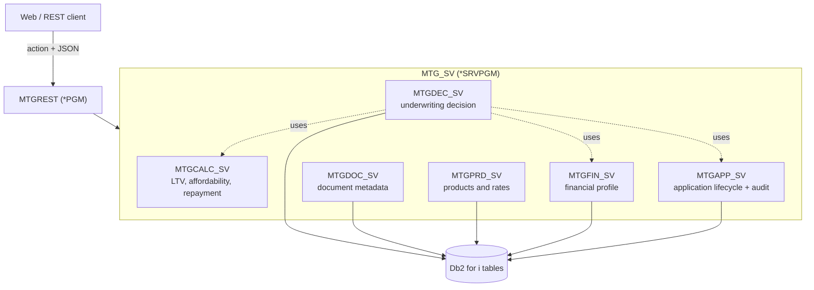
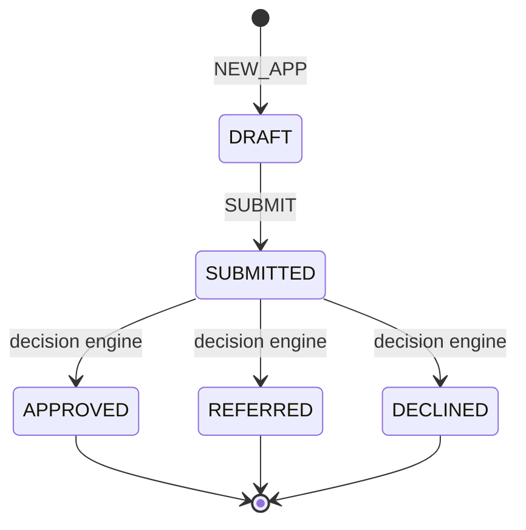
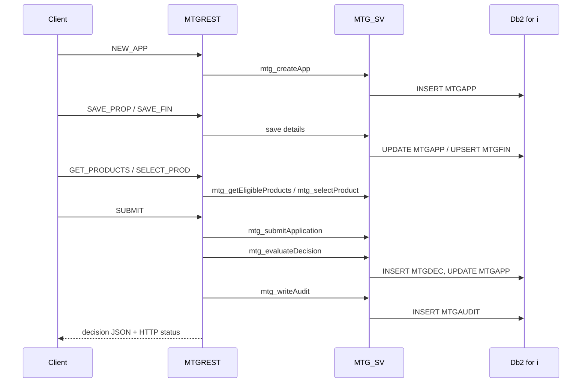
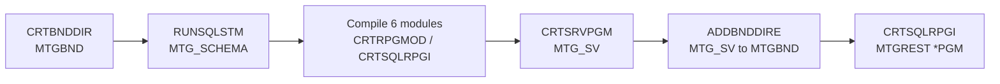
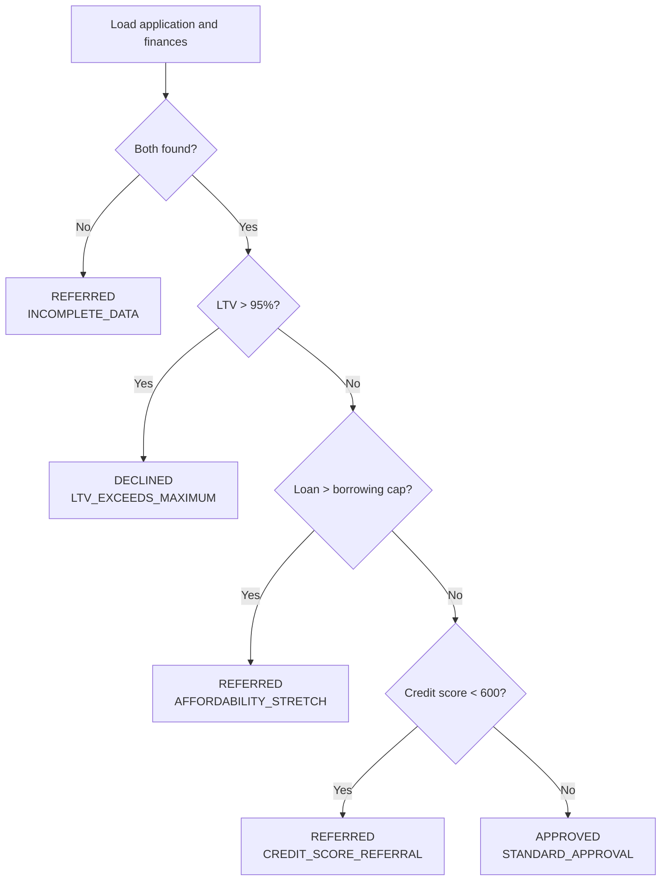
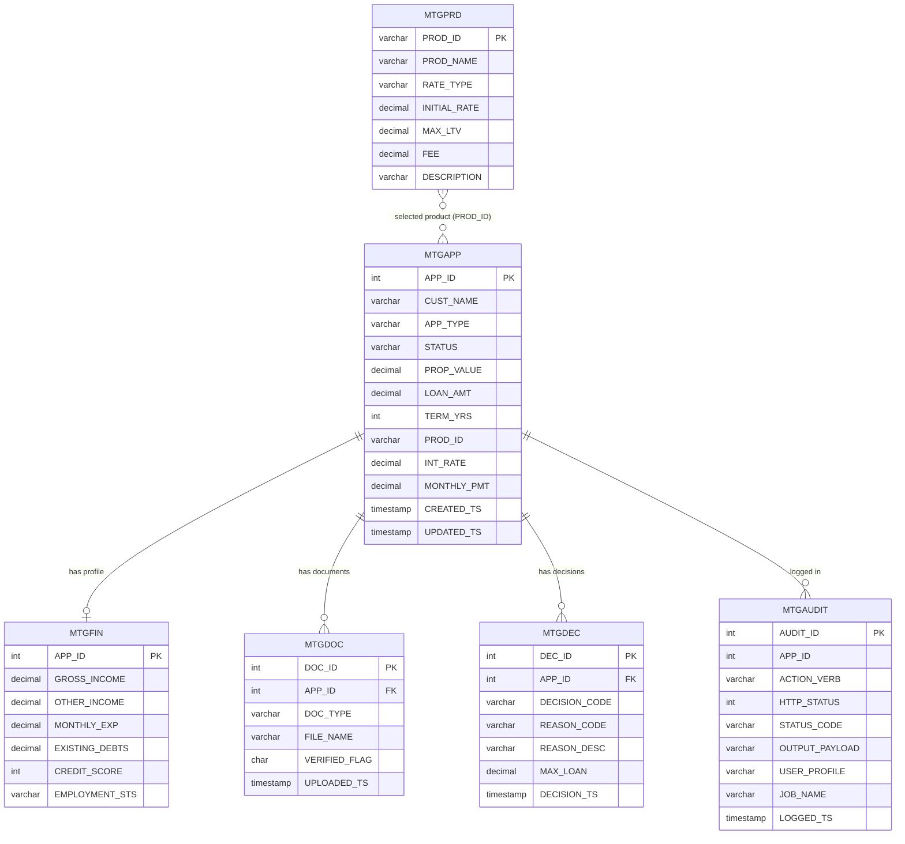

# IBM i Mortgage Application Demo

A back-end mortgage application engine for IBM i, written in modern free-format ILE RPG with embedded SQL on Db2 for i. It simulates a customer applying for a residential mortgage: capturing property and financial details, calculating loan-to-value (LTV), affordability and repayments, matching mortgage products, recording supporting documents, and producing an automated underwriting decision.

> **Important:** This is a demonstration application, not a production lending system. All products, rates, credit scores, documents and decisions are simulated or illustrative. Do not use it to make real lending decisions.

Two specification documents are included:

- [`Mortgage Application Specification.md`](Mortgage%20Application%20Specification.md) - the full functional specification for a mortgage application (customer journey, business rules, roles, data model).
- [`Mortgage_Demo_IBMi_RPG_Spec.md`](Mortgage_Demo_IBMi_RPG_Spec.md) - the lightweight design specification for the IBM i RPG showcase: the module-to-journey mapping, planned REST endpoints, schema and a proposed web front end.

This repository implements the RPG back end described in the lightweight specification, which is itself a simplified, API-first subset of the full specification (see [Scope and known limitations](#scope-and-known-limitations)).

## Table of contents

- [Features](#features)
- [Architecture](#architecture)
- [Repository structure](#repository-structure)
- [Prerequisites](#prerequisites)
- [Getting started](#getting-started)
- [Build process](#build-process)
- [Calling the API](#calling-the-api)
- [Business rules](#business-rules)
- [Database schema](#database-schema)
- [Service program reference](#service-program-reference)
- [Audit trail](#audit-trail)
- [Scope and known limitations](#scope-and-known-limitations)
- [Security considerations](#security-considerations)
- [Suggested next steps](#suggested-next-steps)

## Features

- Create and track mortgage applications through a defined status lifecycle (`DRAFT`, `SUBMITTED`, `APPROVED`, `REFERRED`, `DECLINED`).
- Save property value, requested loan amount and term.
- Save an applicant financial profile (income, expenditure, debts, credit score, employment status).
- Calculate loan-to-value, indicative maximum borrowing and monthly repayment.
- Look up eligible mortgage products by LTV from a seeded product catalogue.
- Record the chosen product, interest rate and monthly payment against the application.
- Record document metadata (simulated upload and verification).
- Run a rule-based underwriting decision with an explanation (reason code and description).
- Write every API call to an audit table, with a ready-made audit view.
- Single JSON-in / JSON-out entry point (`MTGREST`) suitable for fronting with a web or REST layer.

## Architecture

A single `*PGM` (`MTGREST`) acts as the request router. It parses JSON with SQL `JSON_VALUE` and calls procedures exported by one service program (`MTG_SV`). The service program is built from six modules, each owning one area of the business logic.



### Application lifecycle



### Typical request flow



## Repository structure

```
.
|-- Mortgage Application Specification.md   Functional specification
|-- Mortgage_Demo_IBMi_RPG_Spec.md          Lightweight IBM i / RPG design specification
|-- qcllesrc/
|   `-- BUILD_APP.clle                      CL build script
|-- qddlsrc/
|   |-- MTG_SCHEMA.sql                      Tables and seed product data
|   `-- MTG_AUDIT_VIEW.sql                  Audit trail view
|-- qrpglesrc/
|   |-- MTG_H.rpgleinc                      Shared constants, templates, prototypes
|   |-- MTGCALC_SV.rpgle                    Calculation module
|   |-- MTGAPP_SV.sqlrpgle                  Application lifecycle + audit module
|   |-- MTGFIN_SV.sqlrpgle                  Financial profile module
|   |-- MTGPRD_SV.sqlrpgle                  Product module
|   |-- MTGDOC_SV.sqlrpgle                  Document module
|   |-- MTGDEC_SV.sqlrpgle                  Decision engine module
|   `-- MTGREST.sqlrpgle                    JSON request router (*PGM)
`-- qsrvsrc/
    `-- MTG.bnd                             Binder source (service program exports)
```

The folder names follow the IBM i source file naming convention (`QRPGLESRC`, `QDDLSRC`, `QCLLESRC`, `QSRVSRC`) so each folder maps naturally onto a source physical file.

### Objects produced by the build

| Object | Type | Built from |
|---|---|---|
| `MTGBND` | `*BNDDIR` | Created by `BUILD_APP` |
| `MTGAPP`, `MTGFIN`, `MTGPRD`, `MTGDOC`, `MTGDEC`, `MTGAUDIT` | Db2 tables | `MTG_SCHEMA.sql` |
| `V_MTG_AUDIT_TRAIL` | Db2 view | `MTG_AUDIT_VIEW.sql` |
| `MTGCALC_SV`, `MTGAPP_SV`, `MTGFIN_SV`, `MTGPRD_SV`, `MTGDOC_SV`, `MTGDEC_SV` | `*MODULE` | Matching `qrpglesrc` member |
| `MTG_SV` | `*SRVPGM` | Six modules + `MTG.bnd` |
| `MTGREST` | `*PGM` | `MTGREST.sqlrpgle` |

## Prerequisites

- IBM i with ILE RPG and the Db2 for i SQL Development Kit (needed for `CRTSQLRPGI`).
- A target library for the objects, with authority to create tables, modules, service programs and programs.
- Free-format RPG support (`**FREE`) and SQL JSON functions (`JSON_VALUE`), which require a reasonably current IBM i release. Check your release against the IBM documentation for these features.
- Optional but recommended: [Code for IBM i](https://codefori.github.io/docs/) in VS Code for editing and compiling.

## Getting started

1. **Create a library** (or choose an existing one):

   ```
   CRTLIB LIB(MTGDEMO) TEXT('Mortgage demo')
   ```

2. **Create the source physical files** and load the members. `BUILD_APP` reads source from `QRPGLESRC`, `QDDLSRC` and `QSRVSRC` in the target library:

   ```
   CRTSRCPF FILE(MTGDEMO/QRPGLESRC) RCDLEN(240)
   CRTSRCPF FILE(MTGDEMO/QDDLSRC)   RCDLEN(240)
   CRTSRCPF FILE(MTGDEMO/QSRVSRC)   RCDLEN(240)
   CRTSRCPF FILE(MTGDEMO/QCLLESRC)  RCDLEN(240)
   ```

   Copy each file from this repository into the matching source file, using the file name without extension as the member name (for example `MTGCALC_SV.rpgle` becomes member `MTGCALC_SV` in `QRPGLESRC`).

3. **Add the library to your library list**, then compile and run the build program:

   ```
   ADDLIBLE LIB(MTGDEMO)
   CRTBNDCL PGM(MTGDEMO/BUILD_APP) SRCFILE(MTGDEMO/QCLLESRC) SRCMBR(BUILD_APP)
   CALL PGM(MTGDEMO/BUILD_APP) PARM('MTGDEMO')
   ```

4. **Create the audit view** (not included in `BUILD_APP`):

   ```
   RUNSQLSTM SRCFILE(MTGDEMO/QDDLSRC) SRCMBR(MTG_AUDIT_VIEW) COMMIT(*NONE)
   ```

> **Note on includes:** the RPG modules use `/copy qrpglesrc/MTG_H.rpgleinc`, an IFS-style relative path. Whichever way you build (IFS stream files or source members), make sure the compiler can resolve that include. See [Scope and known limitations](#scope-and-known-limitations).

## Build process

`BUILD_APP` takes one parameter, the target library (it defaults to `*CURLIB` when blank). It performs these steps in order:



1. Create binding directory `MTGBND` (ignores "already exists", `CPF2112`).
2. Run `MTG_SCHEMA.sql` to create the tables and seed the product catalogue.
3. Compile the six modules. `MTGCALC_SV` uses `CRTRPGMOD`; the other five use `CRTSQLRPGI` with `OBJTYPE(*MODULE)` and `CLOSQLCSR(*ENDMOD)`.
4. Create service program `MTG_SV` from the six modules, using `MTG.bnd` as the binder source, with `ACTGRP(*CALLER)`.
5. Add `MTG_SV` to `MTGBND` (ignores "entry already exists", `CPF5D0B`).
6. Compile `MTGREST` as a `*PGM` with `ACTGRP(*NEW)`.

> **Warning:** `MTG_SCHEMA.sql` uses `CREATE OR REPLACE TABLE`, so running the build again **recreates the tables and discards existing data**. It also runs `DELETE FROM MTGPRD` before reseeding products.

## Calling the API

`MTGREST` is a single program with four parameters:

| # | Name | Direction | Type | Description |
|---|---|---|---|---|
| 1 | `pAction` | In | `varchar(30)` | Action verb (case-insensitive) |
| 2 | `pInJson` | In | `varchar(4000)` | JSON request payload |
| 3 | `pOutJson` | Out | `varchar(4000)` | JSON response payload |
| 4 | `pHttpStatus` | Out | `int(10)` | HTTP-style status: 200, 400, 404 or 500 |

Because the parameters are variable-length, the easiest way to call the program interactively is through an SQL stored procedure wrapper. This example is provided for illustration; adjust names and the library to your environment:

```sql
CREATE OR REPLACE PROCEDURE MTGDEMO.MTG_CALL (
    IN  P_ACTION      VARCHAR(30),
    IN  P_IN_JSON     VARCHAR(4000),
    OUT P_OUT_JSON    VARCHAR(4000),
    OUT P_HTTP_STATUS INTEGER
)
LANGUAGE RPGLE
PARAMETER STYLE GENERAL
EXTERNAL NAME 'MTGDEMO/MTGREST';
```

```sql
CALL MTGDEMO.MTG_CALL('NEW_APP', '{"custName":"Jane Doe","appType":"FIRST_TIME"}', ?, ?);
```

The program can also be exposed as a REST service, for example through IBM i Integrated Web Services. If you do, add `PGMINFO(*PCML:*MODULE:*DCLCASE)` to the control options of the program being deployed.

### Actions

| Action | Purpose | Request fields | Success response |
|---|---|---|---|
| `NEW_APP` | Create a draft application | `custName`, `appType` | `appId`, `status`, `message` |
| `SAVE_PROP` | Save property and loan details | `appId`, `propValue`, `loanAmount`, `termYears` | `appId`, `ltv`, `status` |
| `SAVE_FIN` | Save applicant finances | `appId`, `grossIncome`, `otherIncome`, `monthlyExp`, `existingDebts`, `creditScore`, `employmentSts` | `appId`, `maxBorrowing`, `status` |
| `CALCULATE` | Indicative figures, nothing stored | `propValue`, `loanAmount`, `rate`, `termYears`, `grossIncome`, `otherIncome`, `monthlyExp`, `existingDebts` | `ltv`, `maxBorrowing`, `monthlyPayment` |
| `GET_PRODUCTS` | List eligible products | `ltv` | `count`, `products[]` |
| `SELECT_PROD` | Record the chosen product | `appId`, `prodId`, `rate`, `monthlyPmt` | `appId`, `selectedProd`, `status` |
| `ADD_DOC` | Record document metadata | `appId`, `docType`, `fileName` | `appId`, `status` |
| `SUBMIT` | Submit and run the decision engine | `appId` | `appId`, `decision`, `reasonCode`, `reasonDesc`, `maxLoan` |
| `GET_STATUS` | Retrieve application state | `appId` | Full application record |

Any other action returns HTTP status `400` with `{"error":"Unknown action: ..."}`.

### Defaults applied when a field is missing

| Field | Default |
|---|---|
| `custName` | `Valued Customer` |
| `appType` | `FIRST_TIME` |
| `termYears` | `25` |
| `rate` (`CALCULATE`) | `4.25` |
| `creditScore` | `720` |
| `employmentSts` | `PERMANENT_FT` |
| `ltv` (`GET_PRODUCTS`) | `80.00` |
| `docType` / `fileName` | `PAYSLIP` / `document.pdf` |
| All other numeric fields | `0` |

### Worked example

**1. Create an application**

```json
{"custName": "Jane Doe", "appType": "FIRST_TIME"}
```

Response (the first application receives ID 1001):

```json
{"appId":1001,"status":"DRAFT","message":"Application initialized"}
```

**2. Save property details** (`SAVE_PROP`)

```json
{"appId": 1001, "propValue": 350000.00, "loanAmount": 280000.00, "termYears": 30}
```

The LTV is 280,000 / 350,000 x 100 = 80.00.

**3. Save finances** (`SAVE_FIN`)

```json
{"appId": 1001, "grossIncome": 85000.00, "otherIncome": 5000.00,
 "monthlyExp": 1800.00, "existingDebts": 350.00, "creditScore": 740}
```

Maximum borrowing = (85,000 + 5,000) x 4.5 - (350 x 12 x 1.5) = 405,000 - 6,300 = 398,700.

**4. Find products** (`GET_PRODUCTS`)

```json
{"ltv": 80.00}
```

Returns products with a maximum LTV of at least 80, cheapest rate first: `FIX5_80`, `FIX2_80`, `FIX5_90` and `VAR_STD`.

**5. Select a product** (`SELECT_PROD`)

```json
{"appId": 1001, "prodId": "FIX2_80", "rate": 4.45, "monthlyPmt": 1420.50}
```

**6. Add a document** (`ADD_DOC`)

```json
{"appId": 1001, "docType": "PAYSLIP", "fileName": "payslip_nov.pdf"}
```

**7. Submit** (`SUBMIT`)

```json
{"appId": 1001}
```

The requested loan (280,000) is below the borrowing cap (398,700), LTV is under 95%, and the credit score (740) is at least 600, so the response is an approval with `reasonCode` `STANDARD_APPROVAL`.

## Business rules

All rules below are illustrative demo values and are hard-coded in the source. The specification calls for configurable rules; see [Scope and known limitations](#scope-and-known-limitations).

### Calculations (`MTGCALC_SV`)

| Procedure | Rule |
|---|---|
| `mtg_calcLTV` | `loan / property value x 100`. Returns `0.00` if either value is zero or negative. |
| `mtg_calcAffordability` | `(gross income + other income) x 4.5 - (monthly debts x 12 x 1.5)`, never below zero. Returns `0.00` if total income is zero. |
| `mtg_calcRepayment` | Standard amortisation: `M = P x r(1+r)^n / ((1+r)^n - 1)` with monthly rate `r = rate / 100 / 12` and `n = years x 12`. If the rate is zero the principal is divided evenly across the payments. Returns `0.00` for a zero principal or term. |

Notes: `monthlyExp` (monthly expenditure) is passed to `mtg_calcAffordability` but is not currently used in the formula.

### Underwriting decision (`MTGDEC_SV`)

Rules are evaluated in this order and the first match wins:



| Order | Condition | Outcome | Reason code |
|---|---|---|---|
| 1 | Application or financial profile missing | `REFERRED` | `INCOMPLETE_DATA` |
| 2 | LTV above 95% | `DECLINED` | `LTV_EXCEEDS_MAXIMUM` |
| 3 | Requested loan above borrowing cap | `REFERRED` | `AFFORDABILITY_STRETCH` |
| 4 | Credit score below 600 | `REFERRED` | `CREDIT_SCORE_REFERRAL` |
| 5 | None of the above | `APPROVED` | `STANDARD_APPROVAL` |

Every evaluation inserts a row in `MTGDEC` and updates `MTGAPP.STATUS` to the decision code.

### Product eligibility (`MTGPRD_SV`)

A product is eligible when its `MAX_LTV` is greater than or equal to the application LTV. Results are ordered by `INITIAL_RATE` ascending and capped at 10 products.

### Seeded demo products

| Product ID | Name | Rate type | Rate % | Max LTV % | Fee |
|---|---|---|---|---|---|
| `FIX2_60` | 2-Year Fixed Rate (Low LTV) | `FIXED_2YR` | 4.15 | 60 | 995.00 |
| `FIX2_80` | 2-Year Fixed Rate (Standard) | `FIXED_2YR` | 4.45 | 80 | 995.00 |
| `FIX5_80` | 5-Year Fixed Rate (Standard) | `FIXED_5YR` | 4.25 | 80 | 995.00 |
| `FIX5_90` | 5-Year Fixed Rate (High LTV) | `FIXED_5YR` | 4.79 | 90 | 0.00 |
| `VAR_STD` | Standard Variable Tracker | `VARIABLE` | 5.25 | 95 | 0.00 |

## Database schema



| Table | Purpose | Notes |
|---|---|---|
| `MTGAPP` | Application master | `APP_ID` is an identity column starting at 1001 |
| `MTGFIN` | Applicant financial profile | One row per application; `ON DELETE CASCADE` from `MTGAPP` |
| `MTGPRD` | Product catalogue | Seeded by `MTG_SCHEMA.sql` |
| `MTGDOC` | Document metadata | `ON DELETE CASCADE` from `MTGAPP` |
| `MTGDEC` | Decision history | One row per evaluation; `ON DELETE CASCADE` from `MTGAPP` |
| `MTGAUDIT` | API call audit log | No foreign key, so audit rows survive application deletion |

## Service program reference

The shared header [`MTG_H.rpgleinc`](qrpglesrc/MTG_H.rpgleinc) declares the constants, template data structures and prototypes. Every module `/copy`s it, so callers and implementations always share the same definitions.

### Constants

| Group | Constants |
|---|---|
| Return codes | `RC_SUCCESS` (`OK`), `RC_REFER`, `RC_DECLINE`, `RC_ERROR` (`ERR`) |
| Statuses | `STAT_DRAFT`, `STAT_SUBMITTED`, `STAT_APPROVED`, `STAT_REFERRED`, `STAT_DECLINED` |

### Template data structures

| Structure | Used for |
|---|---|
| `ds_Application` | Application master record |
| `ds_FinancialProfile` | Applicant financial profile |
| `ds_Product` | Mortgage product |
| `ds_DecisionResult` | Underwriting outcome and reason |

### Exported procedures

| Module | Procedure | Returns | Description |
|---|---|---|---|
| `MTGCALC_SV` | `mtg_calcLTV` | `packed(5:2)` | Loan-to-value percentage |
| | `mtg_calcAffordability` | `packed(11:2)` | Indicative maximum borrowing |
| | `mtg_calcRepayment` | `packed(9:2)` | Monthly repayment |
| `MTGAPP_SV` | `mtg_createApp` | `int(10)` | New application ID, or 0 on failure |
| | `mtg_savePropertyDetails` | `ind` | Save property value, loan and term |
| | `mtg_submitApplication` | `varchar(20)` | Set status to `SUBMITTED`; returns `ERR` on SQL failure |
| | `mtg_getApplicationStatus` | `ind` | Load the application record |
| | `mtg_writeAudit` | `ind` | Insert an audit row |
| `MTGFIN_SV` | `mtg_saveFinances` | `ind` | Insert or update the financial profile |
| | `mtg_getFinances` | `ind` | Load the financial profile |
| `MTGPRD_SV` | `mtg_getEligibleProducts` | `int(5)` | Fill a product array (max 10); returns count |
| | `mtg_selectProduct` | `ind` | Store product, rate and payment on the application |
| `MTGDOC_SV` | `mtg_addDocMetadata` | `ind` | Insert a document record (marked verified) |
| `MTGDEC_SV` | `mtg_evaluateDecision` | `ind` | Run underwriting rules and persist the result |

[`MTG.bnd`](qsrvsrc/MTG.bnd) lists these as exported symbols with signature `MTG_DEMO_V1.0`. If you add or remove an exported procedure, update the binder source in the same change.

## Audit trail

Each `MTGREST` call writes a row to `MTGAUDIT` containing the action, HTTP status, a status code, the response JSON, the user profile and a timestamp. The view `V_MTG_AUDIT_TRAIL` joins the audit rows to the customer name and sorts newest first:

```sql
SELECT AUDIT_ID, APP_ID, CUST_NAME, ACTION_VERB, HTTP_STATUS, STATUS_CODE, LOGGED_TS
  FROM V_MTG_AUDIT_TRAIL
 FETCH FIRST 20 ROWS ONLY;
```

## Scope and known limitations

This repository is a deliberately simplified implementation. Compared with the specification, these items are not implemented or are simplified:

**Differences from the lightweight design specification**
- The web front end (single-page HTML/CSS/JavaScript wizard) described in the design specification is not part of this repository.
- The design specification maps nine REST endpoints (for example `POST /api/application/new`). The code instead provides one action-based program, `MTGREST`, and expects a separate REST layer to route HTTP requests to it.
- `mtg_saveApplicant` and `mtg_getDocsList` are listed in the design specification but are not implemented.
- `mtg_getEligibleProducts` takes only the LTV and fills an array. The specification shows a term parameter and a JSON output parameter.
- `mtg_calcAffordability` takes the other income as an extra parameter, and uses `(income x 4.5) - (annual debts x 1.5)` rather than the `- (debts x 12)` shown in the specification.
- Decision reason codes differ from the specification (`LTV_EXCEEDS_MAXIMUM` instead of `LTV_TOO_HIGH`, `CREDIT_SCORE_REFERRAL` instead of `CREDIT_REVIEW_REQUIRED`).
- The source members are `.sqlrpgle` where embedded SQL is used, and the schema adds an `UPDATED_TS` column, an `EMPLOYMENT_STS` column, and `ON DELETE CASCADE` relationships.
- The design specification places the copybook in `QCPYSRC`; here it sits in `qrpglesrc` alongside the modules.

**Functional gaps against the full specification**
- No joint applicants, second applicant management, or separate employment and expenditure detail.
- No advisor or administrator roles; there is no authentication or authorisation.
- No status history table, outstanding-actions list, or completion percentage.
- Business rules (LTV threshold, income multiple, credit score cut-off) are hard-coded rather than configurable.
- `SUBMIT` does not check that mandatory fields, declarations or documents are complete before running the decision, and ignores the result of `mtg_submitApplication`. A missing financial profile results in a `REFERRED` decision.
- Product eligibility considers LTV only (not term, repayment type or customer type).
- Document handling stores metadata only and marks each document as verified immediately.
- `monthlyExp` is captured but not used in the affordability calculation.

**Technical observations**
- The audit status code comes from the `dsApp` structure, which is only populated by `GET_STATUS`, so it is blank for most actions.
- `BUILD_APP` does not create `V_MTG_AUDIT_TRAIL`; run [`MTG_AUDIT_VIEW.sql`](qddlsrc/MTG_AUDIT_VIEW.sql) separately.
- Rebuilding recreates all tables and loses data (see [Build process](#build-process)).
- Modules include the header with `/copy qrpglesrc/MTG_H.rpgleinc`. Compiling from source physical file members may require the `/copy file,member` form instead, depending on how you stage the source.
- No automated tests are included yet.
- The code has not been validated against every IBM i release; confirm compile and runtime behaviour on your own system.

## Security considerations

This is demo code. Before reusing any part of it, review these points:

- **JSON output is built by string concatenation** and values are not escaped. Text fields such as customer name or reason text containing quotes or control characters will produce invalid JSON. Use `JSON_OBJECT` / `JSON_ARRAYAGG` or a JSON library for production use.
- **Input is not validated** beyond `COALESCE` defaults and `CAST`. Add range, length and format checks (for example non-negative amounts, credit score range, term limits).
- **SQL is parameterised** through host variables, which protects against SQL injection in the embedded statements.
- **No authentication or authorisation** is performed by `MTGREST`. Control access with object authority on the program and tables, and place any web exposure behind appropriate authentication and TLS.
- **Personal data** (customer name, financial figures) is stored in clear text and written to the audit table in the response payload. Apply your organisation's data protection and retention requirements.
- Create objects with explicit authorities rather than relying on `*PUBLIC` defaults.

## Suggested next steps

1. Add a submission validation step that blocks `SUBMIT` until required data and documents exist.
2. Move thresholds and multiples into a configuration table.
3. Add RPGUnit tests for the pure calculation procedures in `MTGCALC_SV`, then for the decision rules.
4. Replace string-built JSON with SQL JSON generation functions and escape all values.
5. Add a status history table and an advisor review flow.
6. Include `MTG_AUDIT_VIEW.sql` in `BUILD_APP`, and guard the schema script so a rebuild does not drop data.
7. Expose `MTGREST` as a REST service (for example with IBM i Integrated Web Services) and add authentication.

## Disclaimer

All customers, products, rates, credit scores and decisions in this repository are synthetic and illustrative. Nothing here constitutes financial advice, a mortgage offer, or a real lending decision.
